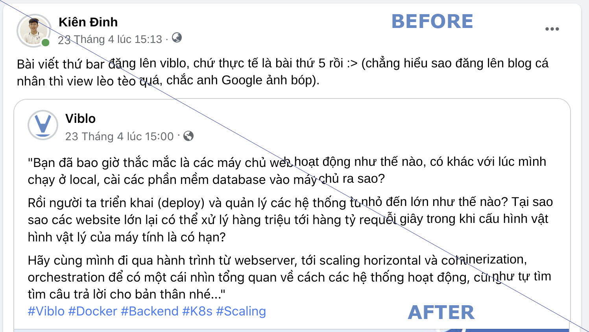
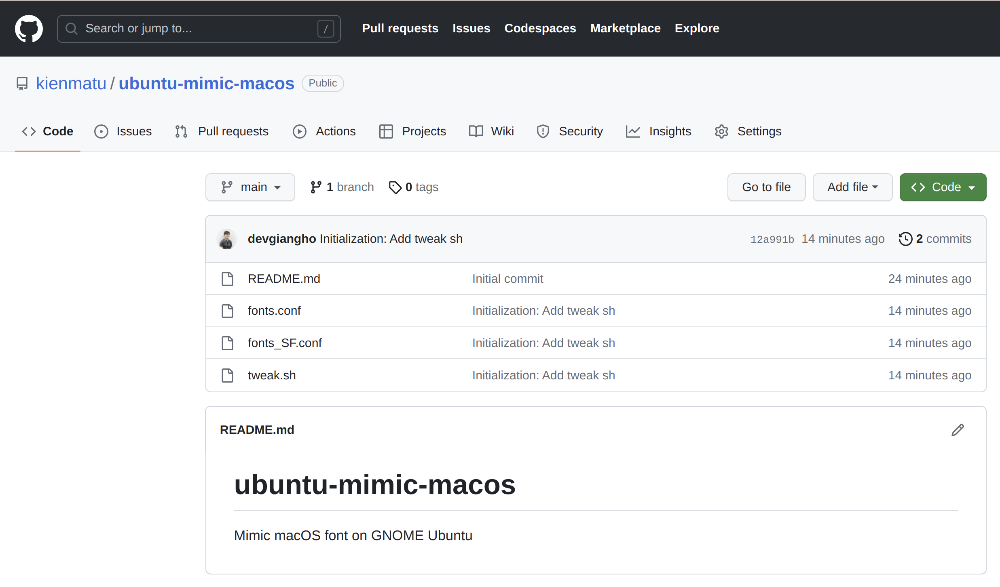
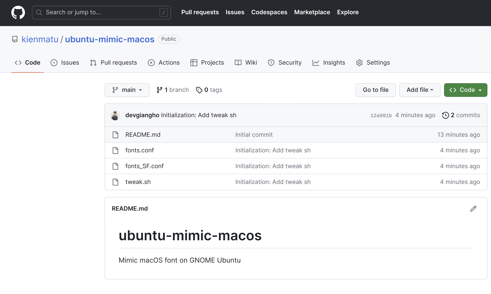
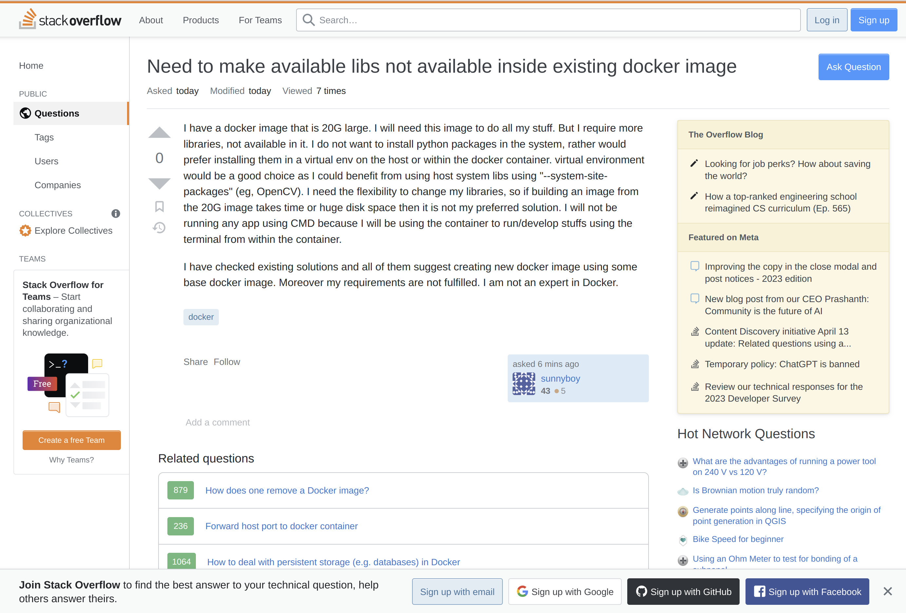
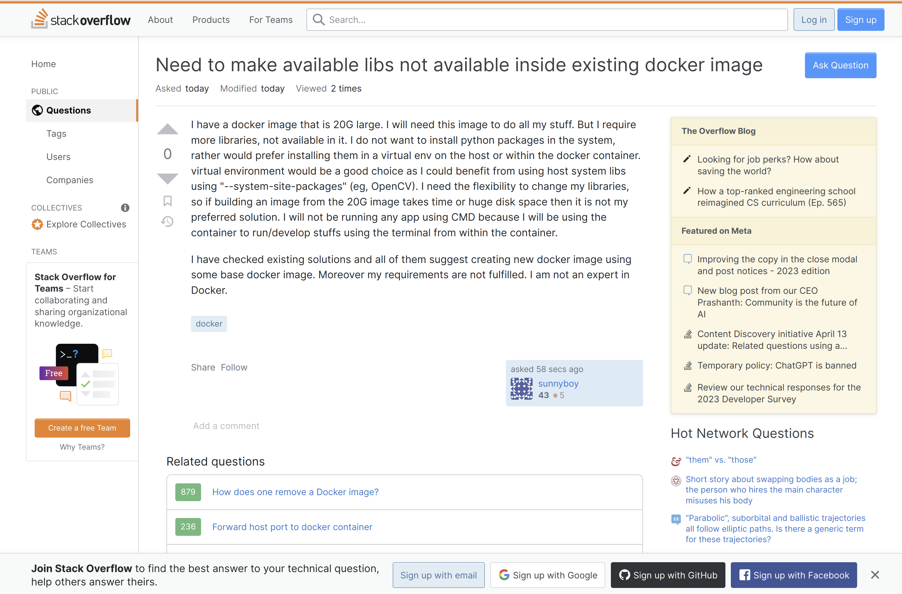

> [!IMPORTANT]  
> This repo is not being maintained anymore since I switched to use a macbook 😂.

# ubuntu-mimic-macos
Mimic the macOS font on Ubuntu (the whole system and most websites).
<div style="display:block">
  
</div>

## Introduction
I want to bring the smooth font UX on macOS into Ubuntu GNOME, Ubuntu MATE, and KDE Plasma (Kubuntu).

So I chose the font `Inter`, it is the font used on Figma and ElementaryOS, and it is open-source.

You also have a choice to change the font into `SF Pro` to have exactly what runs on mac.

I also turned on the **STEM darkening**, that makes the font "bolder, thicker" like mac, but it doesn't work on HiDPI screen which has a big resolution like 4K.

I also use the font alias to trigger `-apple-system`, `Arial` font on almost websites to have a smooth UX thorough all the apps.

## Instructions

- Clone the repo:
    ```bash
    git clone https://github.com/kienmatu/ubuntu-mimic-macos.git
    ```
- Move to the folder:
    ```bash
    cd ubuntu-mimic-macos
    ```
- Make the file executable: 
    ```bash
    chmod +x ./tweak.sh
    ```
- run (without sudo)
    GNOME version:
    ```bash
    ./tweak.sh
    ``` 

    Plasma version:
    ```bash
    ./tweak_plasma.sh
    ```

    Ubuntu MATE version:
    ```bash
    chmod +x ./tweak_mate.sh
    ./tweak_mate.sh
    ```
- logout and login again.
- tadaaaa
### Options
- `-sf`,`--sf-mode`: Using Sans Francisco instead of Inter
- `-s`, `--size`: Change the font size, default font size is 11pt.

Example:
```bash
./tweak.sh -s 12 -sf
```

The same options are supported by `tweak_mate.sh`, for example:
```bash
./tweak_mate.sh -s 12 -sf
```

To restore the Ubuntu MATE font settings that were active before the script was first run:
```bash
./tweak_mate.sh --revert
```

The revert operation restores the previous MATE and fontconfig settings. If no backup exists (for example, after using an older script), the MATE keys are reset to their defaults. Fonts and packages that were installed are left in place so other applications are not disrupted.
## Screenshots

| Before | After |
| ------ | ----- |
|  |  |
|  |  |
|  |  |
